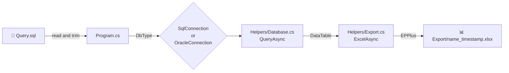

# 📊 Database to Excel


A small console program that runs a SQL query against **Microsoft SQL Server** or **Oracle** and saves the result as an **Excel (.xlsx)** file.

> **About this version**
> Version 2.0 is an upgrade of the [original version](#-whats-new-in-20). The code changes were made by **[Claude Code](https://claude.com/claude-code)**, based on a codebase review and on testing carried out by the repository owner, **Phongsathorn** ([@toyz0](https://github.com/toyz0)).

---

## 📑 Table of Contents

- [Features](#-features)
- [Requirements](#-requirements)
- [Quick Start](#-quick-start)
- [Configuration](#%EF%B8%8F-configuration)
- [How It Works](#-how-it-works)
- [Project Structure](#-project-structure)
- [Developer Guide](#-developer-guide)
- [What's New in 2.0](#-whats-new-in-20)
- [Testing](#-testing)
- [Known Limitations](#%EF%B8%8F-known-limitations)
- [Credits](#-credits)

---

## ✨ Features

- 🗄️ Works with **SQL Server** and **Oracle**. You switch between them with one setting.
- 📝 Reads the query from a plain `Query.sql` file, so you do not need to change code for a new query.
- 📅 Formats date columns as real Excel dates: `yyyy-mm-dd` for date-only columns, and `yyyy-mm-dd hh:mm:ss` when the column has a time.
- 🕒 Adds a timestamp to each output file name, so older exports are never overwritten.
- ⏱️ Has no command timeout, so long-running export queries finish.
- 🔒 Can encrypt the workbook with a password (optional).
- 📐 Can auto-fit column widths (optional).

---

## 📋 Requirements

| Item | Version |
|---|---|
| .NET SDK | **10.0** or newer |
| IDE (optional) | **Visual Studio 2026** (VS 2022 does not support `net10.0`) |
| Database | SQL Server (including LocalDB / Express) or Oracle |
| OS | Windows (tested). Other platforms are not tested. |

---

## 🚀 Quick Start

**1. Clone the repository**

```bash
git clone https://github.com/toyz0/DatabaseToExcel.git
cd DatabaseToExcel/DatabaseToExcel
```

**2. Set your database and file name** in `Export.App/Program.cs` (see [Configuration](#%EF%B8%8F-configuration)):

```csharp
private static readonly DbType _dbType = DbType.SqlServer;
private static readonly string _connectionString = "Server=(localdb)\\MSSQLLocalDB;Database=test;Trusted_Connection=True";
private static readonly string _filename = "employee";
```

**3. Write your query** in `Export.App/Query.sql`:

```sql
SELECT EmployeeId, FirstName, LastName, HireDate
  FROM dbo.Employee
```

**4. Build and run**

```bash
dotnet run --project Export.App
```

Or open `DatabaseToExcel.sln` in Visual Studio 2026 and press **F5**.

**5. Find your file** next to the program:

```
Export.App/bin/Debug/net10.0/Export/employee_20261024_195403.xlsx
```

> 💡 `Query.sql` is copied next to the `.exe` when you build. **Build again after you change the query.** If you do not, the program still uses the old query.

---

## ⚙️ Configuration

All settings are at the top of `Export.App/Program.cs`.

| Setting | Description | Example |
|---|---|---|
| `_dbType` | Which database to use | `DbType.SqlServer` or `DbType.Oracle` |
| `_connectionString` | Connection string for that database | see below |
| `_filename` | Start of the output file name. A timestamp and `.xlsx` are added to it. | `employee` gives `employee_20261024_195403.xlsx` |

### Connection string examples

```text
# SQL Server LocalDB, Windows Authentication
Server=(localdb)\MSSQLLocalDB;Database=test;Trusted_Connection=True

# SQL Server Express, Windows Authentication
Server=localhost\SQLEXPRESS;Database=test;Trusted_Connection=True;TrustServerCertificate=True

# SQL Server, SQL login
Server=myserver;Database=mydb;User Id=myuser;Password=mypassword;TrustServerCertificate=True

# Oracle
Data Source=myhost:1521/myservice;User Id=myuser;Password=mypassword
```

> ⚠️ **Security:** This repository is public. **Never commit a connection string that contains a password.**
>
> ℹ️ SQL Server drivers turn on encryption by default. If you see `The certificate chain was issued by an authority that is not trusted`, add `TrustServerCertificate=True` to the connection string.

> ⚠️ `_filename` must not contain characters that Windows does not allow in file names: `< > : " / \ | ? *`

### Optional export settings

`Main` calls `ExportExcelAsync(dt, isAutoFitColumns, password)`:

| Parameter | Default | Effect |
|---|---|---|
| `isAutoFitColumns` | `false` | Widens each column to fit its content |
| `password` | `null` | Encrypts the workbook with this password |

---

## 🔄 How It Works



1. **Read**: `Program` reads `Query.sql` and removes spaces and a trailing `;` at the end. Oracle rejects a trailing `;`.
2. **Query**: `Program` creates a `SqlConnection` or an `OracleConnection` from `_dbType`. `Database.QueryAsync` runs the query and loads the result into a `DataTable`.
3. **Export**: `Export.ExcelAsync` writes the `DataTable` to one sheet with a header row, formats the date columns, and saves the file straight to disk.

---

## 🗂️ Project Structure

```
DatabaseToExcel/
├── README.md
├── .gitignore
└── DatabaseToExcel/
    ├── DatabaseToExcel.sln          # Visual Studio 2026 solution
    │
    ├── Export.App/                  # Console app (entry point)
    │   ├── Export.App.csproj        # net10.0, copies Query.sql to the output folder
    │   ├── Program.cs               # Settings + the read → query → export flow
    │   └── Query.sql                # The SQL query to export
    │
    └── Helpers/                     # Class library (reusable logic)
        ├── Helpers.csproj           # net10.0 + NuGet packages
        ├── Database.cs              # Runs a query on any ADO.NET connection → DataTable
        └── Export.cs                # DataTable → .xlsx file (EPPlus)
```

### Projects

| Project | Type | Responsibility |
|---|---|---|
| `Export.App` | Console app | Holds the settings, reads `Query.sql`, picks the database driver, and decides where the output file goes. |
| `Helpers` | Class library | Contains the logic that has no settings: running a query and writing an Excel file. It does not depend on `Export.App`. |

### Dependencies (`Helpers.csproj`)

| Package | Version | Used for |
|---|---|---|
| [EPPlus](https://www.nuget.org/packages/EPPlus) | 7.1.2 | Writing `.xlsx` files |
| [Microsoft.Data.SqlClient](https://www.nuget.org/packages/Microsoft.Data.SqlClient) | 7.1.1 | SQL Server driver |
| [Oracle.ManagedDataAccess.Core](https://www.nuget.org/packages/Oracle.ManagedDataAccess.Core) | 23.26.400 | Oracle driver |
| [System.Security.Cryptography.Pkcs](https://www.nuget.org/packages/System.Security.Cryptography.Pkcs) | 10.0.13 | Pinned to fix CVE-2026-84008 in a transitive dependency. You can remove it once the drivers ship a patched version. |

---

## 🛠️ Developer Guide

### Key APIs

```csharp
// Helpers/Database.cs
// Works with any ADO.NET provider. The caller owns and disposes the connection.
Task<DataTable> Database.QueryAsync(
    DbConnection conn, string sqlCommand, CommandType commandType, params DbParameter[] parameters);

// Helpers/Export.cs
// Writes dt to filePath as a single sheet. Overwrites the file if it exists.
Task Export.ExcelAsync(
    DataTable dt, string filePath, bool isAutoFitColumns = false, string? password = null);
```

### Adding another database

`Database.QueryAsync` accepts any `DbConnection`, so adding a database (for example PostgreSQL with `Npgsql`) needs no change in `Helpers/Database.cs`:

1. Add the driver package to `Helpers.csproj`.
2. Add a value to the `DbType` enum in `Program.cs`.
3. Create the matching connection in `Program.GetAsync`.

### Things to keep in mind

- `DbType` is declared **inside** `Program` on purpose. A top-level `DbType` would clash with `System.Data.DbType`.
- `Database.QueryAsync` sets `CommandTimeout = 0` (no limit). Without it, SQL Server stops a query after 30 seconds.
- For Oracle, `Database.QueryAsync` turns on `SuppressGetDecimalInvalidCastException`. Oracle `NUMBER` can hold more digits than .NET `decimal`. Without this setting, such values throw `InvalidCastException`.
- The EPPlus license is set once, in the static constructor of `Export`.

### Build

```bash
cd DatabaseToExcel
dotnet build
dotnet list package --vulnerable --include-transitive   # check for vulnerable packages
```

---

## 🆕 What's New in 2.0

Version 2.0 upgrades the original version (1.0, .NET 8). **All changes were made by Claude Code**, based on a review of the codebase and on testing by the repository owner.

### Platform

| | 1.0 | 2.0 |
|---|---|---|
| Target framework | .NET 8 | **.NET 10** |
| Solution format | Visual Studio 2022 | **Visual Studio 2026** |
| Microsoft.Data.SqlClient | 5.2.0 | **7.1.1** |
| Oracle.ManagedDataAccess.Core | 23.4.0 | **23.26.400** |
| Known vulnerable packages | 5 (3 rated High) | **0** |

### 🐛 Bug fixes

- **Dates exported as numbers.** Date columns showed values like `43525` instead of `2019-03-01`. Date columns now have an Excel date format.
- **SQL Server timeout after 30 seconds.** Long export queries failed with `Execution Timeout Expired`. The timeout is now turned off.
- **Oracle `NUMBER` with long decimals.** Values like `1/3` could throw `InvalidCastException`. They are now truncated to fit .NET `decimal`.
- **Trailing `;` on Oracle.** A query that ended with `;` failed with `ORA-00911`. The trailing `;` is now removed.
- **`Query.sql` not found when running the `.exe`.** The file was not copied to the output folder. It is now copied, and paths are resolved from the program's own folder.
- **Output overwritten on every run.** File names now include a timestamp.
- **Auto-fit crashed on an empty sheet.** It now skips an empty sheet.

### ♻️ Refactoring

- `Oracle.cs` and `SqlServer.cs` were two copies of the same code. They are merged into one **`Database.cs`**, which accepts any `DbConnection`.
- Queries now use **`ExecuteReaderAsync`**. The old code called the blocking `DataAdapter.Fill`.
- To switch databases, you now set the **`DbType` enum**. You no longer comment and uncomment code.
- The Excel file is saved **straight to disk**. The workbook is no longer copied into a `byte[]` first.
- Removed code that had no effect: connection state checks, `Parameters.Clear()` on a new command, and closing connections twice.

### 🔐 Security & housekeeping

- Fixed vulnerable transitive packages: `System.Security.Cryptography.Pkcs`, `System.Text.Json`, `System.Formats.Asn1`, `Azure.Identity` and `Microsoft.Identity.Client`.
- The connection string is now a single, clearly marked setting, with a warning not to commit passwords.
- `.gitignore` now covers `bin/`, `obj/`, `.vs/` and `*.user` for every project.
- Added English comments in the code where the reason is not obvious.

---

## 🧪 Testing

Version 2.0 was tested by hand:

| Area | Environment | Result |
|---|---|---|
| Build | .NET SDK 10.0.402, Windows 11 | ✅ 0 errors, 0 warnings |
| Vulnerability scan | `dotnet list package --vulnerable --include-transitive` | ✅ No vulnerable packages |
| SQL Server export | SQL Server 2025 LocalDB, Windows Authentication | ✅ Passed |
| Data types | 10 rows × 10 columns: `INT`, `VARCHAR`, `NVARCHAR` (Thai text), `DECIMAL`, `DATE`, `DATETIME2`, `BIT`, `NULL` values, text with `'` | ✅ All values match the source |
| Refactor safety | Output compared cell by cell with the output from before the refactor | ✅ Same values |
| Run from another folder | `Export.App.exe` started from `C:\` | ✅ Passed |
| Trailing `;` in `Query.sql` | SQL Server | ✅ Passed |
| Auto-fit columns | `isAutoFitColumns = true` | ✅ Column widths set |
| Oracle | — | ⚠️ **Not tested** (no Oracle server was available) |

> There are no automated tests yet. A good first test: build a `DataTable` with a `DateTime` column and a `DBNull` value, call `Export.ExcelAsync`, and check the file it writes.

---

## ⚠️ Known Limitations

- **Oracle is not tested in 2.0.** The Oracle code path builds, but no Oracle server was available for testing.
- **Excel row limit.** One sheet holds at most 1,048,576 rows. A larger result fails when the sheet is written.
- **Memory.** The whole result is loaded into memory as a `DataTable` before export.
- **EPPlus license.** EPPlus 5 and newer is free **only for non-commercial use**. Commercial use needs a [paid license](https://epplussoftware.com/), or you can switch to an MIT-licensed library such as ClosedXML.
- **Settings in code.** You change the database and file name in `Program.cs` and rebuild.

---

## 🙏 Credits

- **Original author and owner:** Phongsathorn ([@toyz0](https://github.com/toyz0))
- **Version 2.0 upgrade:** made with [Claude Code](https://claude.com/claude-code), based on the owner's codebase review and testing.
